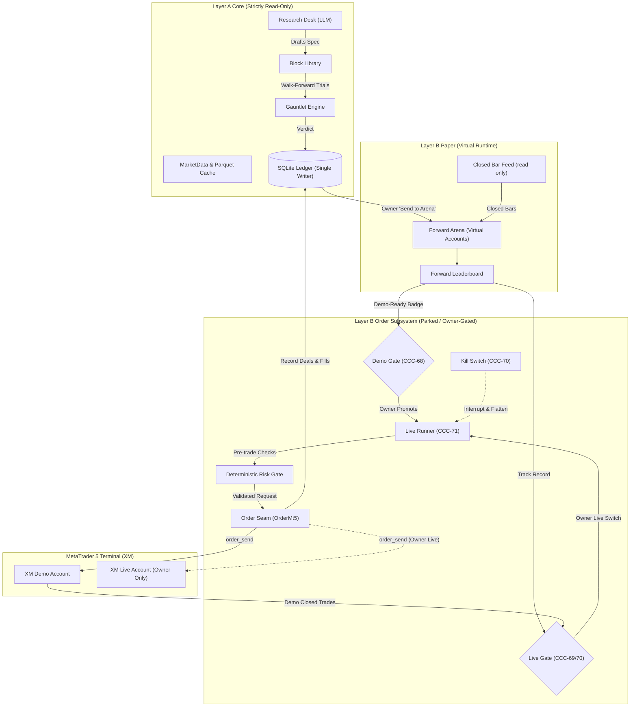
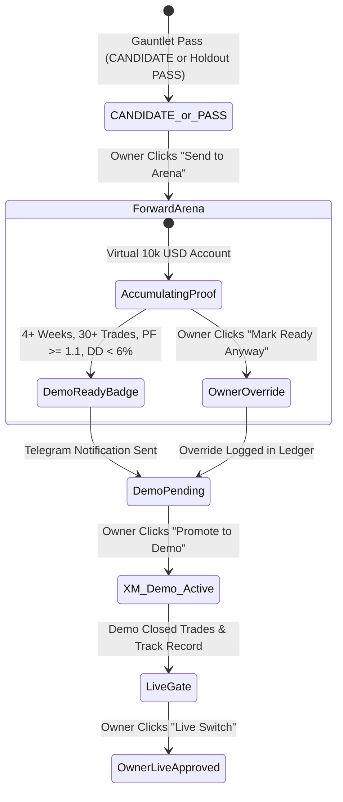
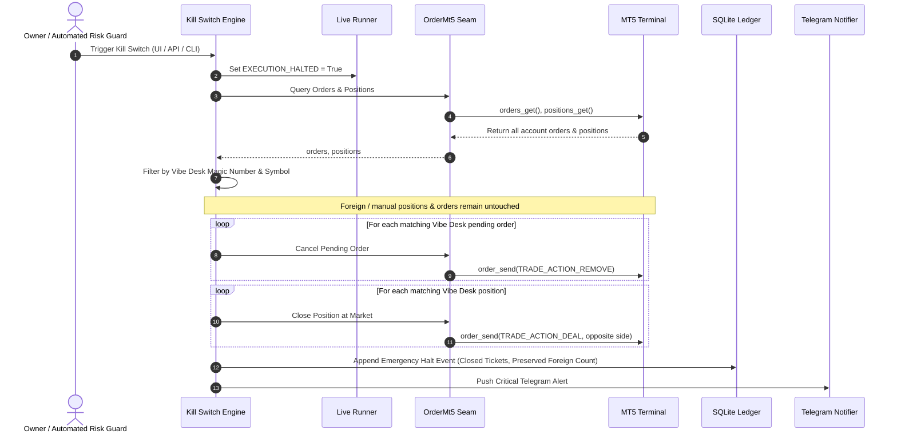
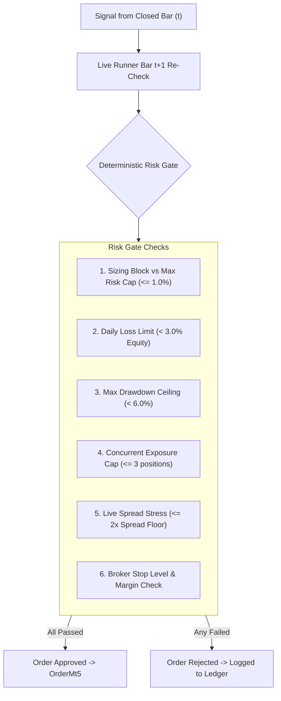
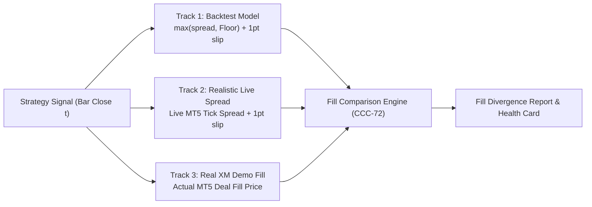

# Design: Order-Side Architecture (Demo Gate, Live Switch, Kill Switch, and Execution Seams)

- **Status:** PARKED / DESIGN DOCUMENT ONLY (No implementation code, no real orders)
- **Scope:** Layer B order-placing cards:
  - **CCC-68:** Demo gate (Arena leaders graduate to the XM demo)
  - **CCC-70:** Owner-only live switch and kill switch
  - **CCC-82:** Basic live EA (parked evaluation)
  - **CCC-72 (demo half):** Virtual vs demo fills comparison
  - **CCC-71 (live half):** Live runner re-checks time filters against the fill bar
- **Inputs:** `AGENTS.md`, `CLAUDE.md`, `CONTEXT.md`, `docs/intent/vibe-desk.md`, `docs/spec/layer-a-verdict-engine.md`, `docs/adr/*`, owner grill decisions (2026-10-30).
- **Rule in force:** **"No orders, ever"** remains mandatory for all coding agents and automated CI tests. This document provides the architectural specification for the owner's eventual implementation decisions.

---

## 1. Executive Summary & Core Invariants

Vibe Desk is built on a strict separation between research and money. Layer A creates Strategy Specs from the Block Library, runs Trials through the Gauntlet, and records Verdicts in the Ledger. Layer B paper trading introduces the Forward Arena (CCC-66), where CANDIDATE and PASS Hypotheses trade virtual 10,000 USD accounts on real incoming closed bars with zero market orders.

The order side governs what happens when a strategy proves itself forward:
1. **Paper to Demo (CCC-68):** A strategy that earns the **Demo-ready badge** in the Forward Arena may graduate to live demo order routing on the XM Demo terminal.
2. **Demo to Live (CCC-70):** A strategy that clears the **Live Gate** (CCC-69) across statistical trade counts per timeframe may be switched to live real-money execution **only by the owner**.
3. **Emergency Halt (CCC-70):** A physical **Kill Switch** accessible via UI, API, and CLI flattens owned open positions and halts all order execution within one tick.

### Core Architectural Invariants

| Invariant | Enforcement Mechanism |
|---|---|
| **AI Never Orders** | The Research Desk and OmniRoute LLM have zero tools, tokens, or permissions to touch accounts, submit orders, or promote strategies. |
| **Deterministic Execution** | Orders fire solely from deterministic Block evaluation on closed bars. No per-candle LLM call exists. |
| **Single-Writer Ledger** | Every order, fill, slippage delta, and state transition appends to the SQLite Ledger (`data/desk.db`). |
| **Fail-Closed Risk Gate** | Every order must pass pre-trade risk validation (max risk, exposure, spread ceiling, daily loss limit) before reaching the broker seam. |
| **Isolated Order Seam** | Read-only market data (`market/`) remains strictly read-only. Order calls are quarantined to an isolated execution adapter. |

---

## 2. Architecture & Isolation Boundaries

### 2.1 Component Topology

Order capabilities must never leak into the research engine, market cache, or AI desk loop. The execution system sits downstream of the Forward Arena and Ledger:



### 2.2 Subsystem Code Location

When built, order execution code must live in a dedicated, isolated package:
```
src/vibedesk/execution/
├── __init__.py
├── gate.py            # Demo & Live gate validators
├── risk.py            # Pre-trade Risk Gate (caps, daily limits, spread floors)
├── runner.py          # Bar-close execution loop & time-filter re-checker
├── kill_switch.py     # Flatten owned positions, cancel owned orders, halt loop
├── seam.py            # OrderMt5 protocol and wrapper
├── fake_order_mt5.py  # In-memory order simulator for pytest suites
└── reconcile.py       # State reconciliation on reconnect / boot
```

> **Note on Fill Comparison (CCC-72):** Per the 2026-10-30 grill decision, the comparison engine between the backtest-cost track and the realistic live-spread track is built now, order-free, as part of Layer B paper work (located alongside the Forward Arena in `src/vibedesk/arena/comparison.py`). It does NOT belong in `execution/`. When demo order execution is later unparked, `execution/seam.py` only feeds Track 3 demo deal records into the Arena's comparison engine via an append-only deal interface.

### 2.3 Strict Isolation from AI & Research Desk

1. **Zero AI Tooling:** The Research Desk toolset (`src/vibedesk/desk/tools.py`) contains only `list_blocks`, `describe_data`, `draft_spec`, `register_hypothesis`, `run_trial`, `get_trial`, `request_holdout`. No execution tools exist.
2. **MCP Zero Owner Tooling:** The stdio MCP server (`vibedesk-mcp`) explicitly omits all owner tools, budget tools, and execution endpoints. It runs over the HTTP API without the owner authentication cookie.
3. **No Execution From Chat:** Chat messages never trigger orders. Strategies reach execution only through the explicit path: `Hypothesis -> Gauntlet Verdict -> Forward Arena -> Demo Gate -> Owner Confirmation`.

### 2.4 Guard Test Evolution

Currently, `tests/test_guard.py` and `tests/test_mt5_guard.py` protect the codebase from accidental order code. `tests/test_mt5_guard.py` is the primary and stricter guard, enforcing three layers: only `market/mt5_api.py` imports `MetaTrader5`; an AST scan forbids any MT5 function off `ALLOWED_CALLS` across all of `src/`; and `ReadOnlyMt5` refuses non-allowed calls at runtime.

When order execution is implemented, these guards must evolve into a **Quarantine Architecture**:

1. **Regex Guard (`tests/test_guard.py`):**
   - The regex scan for `\b(order_send|order_check|positions_\w*|orders_\w*)\b` continues to assert that NO file in `src/` outside `src/vibedesk/execution/` contains order-related function names.
2. **Three-Layer MT5 Guard (`tests/test_mt5_guard.py`):**
   - **Layer 1 (Import Restriction):** The single-importer check is updated to permit exactly two files to import `MetaTrader5`: `market/mt5_api.py` (read-only data seam) and `execution/seam.py` (order execution seam). Any other import of `MetaTrader5` (including by `importlib` string) across `src/` fails the test.
   - **Layer 2 (AST Function & Attribute Scan):** The AST scanner is partitioned:
     - All packages in `src/` outside `execution/` remain strictly restricted to `ALLOWED_CALLS`. Naming any order or position function (`order_send`, `order_check`, `positions_get`, `orders_get`, `history_deals_get`, `order_calc_margin`) outside `execution/` fails CI immediately.
     - `execution/seam.py` is checked against an explicit `ALLOWED_ORDER_CALLS` allowlist: `frozenset({"order_send", "order_check", "positions_get", "orders_get", "history_orders_get", "history_deals_get", "order_calc_margin", "symbol_info", "symbol_info_tick", "initialize", "shutdown", "last_error"})`.
   - **Layer 3 (Runtime Protection & Decoupled Permissions):**
     - `ReadOnlyMt5` in `market/mt5_api.py` remains 100% read-only and continues to refuse every non-allowed attribute.
     - `OrderMt5` in `execution/seam.py` wraps `MetaTrader5` and enforces decoupled, fail-safe order authorization:
       1. **New Entries (Opening Deals):** Opening a new position (`TRADE_ACTION_DEAL` in entry direction) or placing a pending entry order (`TRADE_ACTION_PENDING`) requires: (a) `LIVE_RUNNER_STATE != "HALTED"`, and (b) an active, durable `LiveGrant` recorded in the Ledger for that specific Hypothesis and symbol. If `HALTED` is active or no valid `LiveGrant` exists in the Ledger, `OrderMt5` raises `ExecutionPermissionError`.
       2. **Exits & Cancellations (Closing Deals & Flatten):** Closing an existing owned position (`TRADE_ACTION_DEAL` closing an active ticket) or cancelling a pending order (`TRADE_ACTION_REMOVE`) is **always permitted**. It does NOT require an active `LiveGrant` and is NOT blocked by `LIVE_RUNNER_STATE == "HALTED"`. This invariant guarantees that triggering the Kill Switch, executing trailing stops, or running the CLI `uv run desk kill-switch` can always flatten owned positions immediately, even when `HALTED` is latched or when no browser session is active.
       3. **Durable Live Grants vs. Browser Sessions:** Strategy live-switch authorization is granted per Hypothesis as an immutable, durable `LiveGrant` in `data/desk.db` (created when the owner activates the live switch via UI with the `vibedesk_owner=1` cookie). The live runner operates autonomously over bar closes for weeks by verifying this durable grant in the Ledger, completely independent of browser cookies or active web sessions.
3. **In-Memory Simulator Isolation:**
   - `FakeOrderMt5` lives in `src/vibedesk/execution/fake_order_mt5.py` (importing `FakeMt5` from `vibedesk.market.fake_mt5`). It MUST NEVER reside in `market/` or anywhere else in `src/` outside `execution/`, ensuring the read-only core is not polluted with order mock state.
   - All automated unit and integration tests run exclusively against `FakeOrderMt5`. Zero network calls or real terminal connections occur in tests.

---

## 3. Demo Graduation Flow (CCC-68)

### 3.1 Graduation Stages



### 3.2 Demo-Ready Badge Criteria

A strategy running in the Forward Arena earns the **Demo-Ready Badge** when it meets all of the following:
1. **Minimum Duration:** Active in Forward Arena for at least **4 calendar weeks** (28 days).
2. **Sample Size:** At least **30 forward closed trades** completed on closed bars.
3. **Forward Profit Factor:** Cumulative forward profit factor $\ge 1.10$.
4. **Drawdown Boundary:** Maximum forward drawdown $< 6.0\%$ from peak virtual equity.
5. **Decay Check:** No significant decay against the Gauntlet expected range, reusing the **CCC-67 Leaderboard decay flag** (`is_decayed == False`). There is exactly one definition of edge decay across Vibe Desk.
   - *[Proposal]*: Candidate quantitative thresholds for CCC-67's decay flag (such as forward PF falling within the 90% confidence interval of the walk-forward folds, or win rate within 2.0 standard deviations of the backtest distribution) are documented as proposals for owner confirmation in Section 12.

### 3.3 Owner Override

The owner may bypass the 4-week or 30-trade waiting period via the web UI ("Mark ready anyway").
- **Audit Requirement:** The bypass event is immutably written to `data/desk.db` in `arena_events` with timestamp, hypothesis ID, current metrics, and `override_reason`.
- The strategy card retains an amber "Owner Override" badge alongside its demo status to maintain transparency.

### 3.4 XM Demo Order Execution

Once promoted to Demo:
- The Live Runner submits real `order_send` requests to the connected XM Demo MT5 terminal.
- Sizing follows the Spec's `fixed_risk` block (default 1.0% risk per trade) calculated on the Demo account balance.
- **Position Limit:** At most **one open position** per Hypothesis. Opposite signals execute stop-and-reverse or exit according to Spec rules.

---

## 4. Owner-Only Live Switch & Live Gate (CCC-70, CCC-69)

### 4.1 Live Gate Requirements (CCC-69)

Transitioning a strategy from the XM Demo to real money is the highest-risk event in Vibe Desk. A strategy must survive the quantitative Live Gate. CCC-69 is specifically scoped to **M15, H1, and H4**; D1 is included below as an optional candidate proposal:

| Criterion | M15 Timeframe | H1 Timeframe | H4 Timeframe | D1 Timeframe [Proposal] |
|---|---|---|---|---|
| **Min Forward Trades** | $\ge 100$ trades | $\ge 60$ trades | $\ge 40$ trades | $\ge 30$ trades *[Proposal]* |
| **Min Track Record** *[Proposal]* | $\ge 8$ weeks | $\ge 8$ weeks | $\ge 12$ weeks | $\ge 16$ weeks |
| **Statistical PF Bound** | Lower 95% bootstrap bound of forward PF $> 1.00$ | Lower 95% bootstrap bound of forward PF $> 1.00$ | Lower 95% bootstrap bound of forward PF $> 1.00$ | Lower 95% bootstrap bound of forward PF $> 1.00$ |
| **Max Drawdown** | $< 6.0\%$ | $< 6.0\%$ | $< 6.0\%$ | $< 6.0\%$ |
| **Execution Quality** *[Proposal]* | Demo slippage within 1.5× Spread Floor | Demo slippage within 1.5× Spread Floor | Demo slippage within 1.5× Spread Floor | Demo slippage within 1.5× Spread Floor |

*Note: The Live Gate requires a formal Architecture Decision Record (ADR) prior to enablement. Every parameter marked `[Proposal]` is documented for explicit owner confirmation in Section 12 before being codified in the ADR.*

### 4.2 Owner Authorization Security Model

1. **Authentication:** The Live Switch endpoint `POST /api/execution/live-switch` strictly requires the `vibedesk_owner=1` cookie (`SameSite=Strict`).
2. **Two-Step Modal Confirmation:** The UI requires the owner to type the symbol name and family ID into a confirmation dialog before sending the activation payload.
3. **Durable Ledger Grant (`LiveGrant`):** Activation creates a durable, immutable `LiveGrant` record in the SQLite Ledger (`data/desk.db`), binding the Hypothesis ID, symbol, git commit hash, `RULES_VERSION`, and authorized sizing. The Live Runner runs autonomously over closed bars for weeks by verifying this durable grant against the Ledger; it does NOT depend on a continuous browser session or transient browser tokens.
4. **Grant Revocation:** A `LiveGrant` is immediately revoked when the owner clicks "Pause Live" or when the Kill Switch is triggered.
5. **Account Quarantine:** Live trading MUST use a dedicated XM Live MT5 terminal instance. It must NEVER run on the terminal instance used for development, backtesting, or demo testing.

---

## 5. The Kill Switch (CCC-70)

The Kill Switch is the ultimate safety stop. It halts execution, closes positions, and prevents catastrophic loss during abnormal volatility, system faults, or broker anomalies.

### 5.1 Scope of Action

When triggered, the Kill Switch executes the following sequence:



1. **State Latch:** Immediately flips `LIVE_RUNNER_STATE = "HALTED"` and revokes/suspends active `LiveGrant`s. All scheduled bar-close triggers reject incoming new entries.
2. **Permission Decoupling (Flattening Invariant):** While `HALTED` blocks all new entry orders, `OrderMt5` explicitly permits closing deals (`TRADE_ACTION_DEAL` opposite side) and cancellations (`TRADE_ACTION_REMOVE`). Latching `HALTED` never blocks the flatten sequence itself, and flattening requires no owner browser session (allowing CLI `uv run desk kill-switch` to operate autonomously).
3. **Ownership Filtering (Ownership Protection Invariant):** The Kill Switch MUST NOT close positions or cancel orders it does not own. On the owner's account, flattening every position indiscriminately would destroy manual discretionary trades (placed directly in the MT5 terminal) or trades from other strategies. The Kill Switch queries `orders_get()` and `positions_get()`, strictly filtering by:
   - **Magic Number:** `order.magic` / `position.magic` matches a registered Vibe Desk strategy magic number (e.g., `VIBEDESK_MAGIC_BASE + hypothesis_id`). Any order or position with magic `0` (manual terminal order) or a foreign magic number is ignored.
   - **Symbol:** `order.symbol` / `position.symbol` matches the symbol registered to that Hypothesis.
   - All manual trades and foreign positions remain completely untouched.
4. **Pending Order Cancellation:** Sends `TRADE_ACTION_REMOVE` strictly for matching Vibe Desk pending limit/stop orders.
5. **Market Flatten:** Dispatches immediate market closing orders (`TRADE_ACTION_DEAL`) strictly for matching Vibe Desk open positions.
6. **Audit Logging:** Logs the halt timestamp, triggering user/system, closed Vibe Desk tickets, exit prices, and count of foreign positions left open to the Ledger.
7. **Telegram Dispatch:** Emits a high-priority alert to the owner's Telegram channel with exit prices, realized P&L, and confirmation of foreign positions preserved.

### 5.2 Latency & Performance Targets

- **Execution Latency:** The Kill Switch must issue market close orders within **$< 1,000\text{ ms}$** of invocation.
- **Retry Logic:** If a broker rejects an emergency close with a transient code (e.g., `TRADE_RETCODE_REQUOTE`), the Kill Switch immediately retries with max slippage tolerance up to 3 times before sounding an audible OS alarm and urgent Telegram alert.

### 5.3 Access Surfaces

- **Web UI:** A sticky, high-contrast red **"KILL SWITCH"** button displayed in the global top header on every page (Desk, Ideas, Ledger, Settings).
- **HTTP API:** `POST /api/execution/kill-switch` (owner cookie required, bypasses normal rate limits).
- **CLI Command:** `uv run desk kill-switch` — directly executable from a local terminal session if the web browser is unresponsive.

### 5.4 Test Strategy Without Real Orders

The Kill Switch must be verified in automated CI without contacting real brokers:
- Driven by `FakeOrderMt5`, which populates mock positions and pending orders.
- The test asserts that upon `kill_switch.trigger()`, all mock positions owned by Vibe Desk transition to closed, all Vibe Desk pending orders are purged, the runner state latches to `HALTED`, and the exact audit event is written to the test database.
- **Permission Decoupling Assertion:** Asserts that the flatten sequence successfully dispatches and executes closing orders *after* `LIVE_RUNNER_STATE = "HALTED"` is latched, and works with zero owner browser session present (simulating CLI `uv run desk kill-switch` or background automated stop).
- **Foreign Position Assertion:** Asserts that any planted foreign or manual positions (`magic=0` or foreign ID) remain open and untouched.

---

## 6. The Risk Gate

The Risk Gate is a deterministic, non-bypassable pre-trade validation engine. Every order generated by a Strategy Spec must pass through the Risk Gate before reaching `OrderMt5`.



### 6.1 Hard Constraints

1. **Max Risk Per Trade:**
   - Sizing is determined strictly by the Spec's `fixed_risk` block (standard default: **1.0%** of current equity).
   - Hard Risk Gate Ceiling: The Risk Gate enforces a hard maximum ceiling of **1.0%** of equity. Any order where lot size rounding or price slippage would risk $> 1.0\%$ of equity under the defined stop distance is rejected.
   - *[Proposal]*: Owner configurable ceiling option up to 1.5% (see Section 12 Decision 3).
2. **Daily Loss Limit:**
   - If cumulative closed + floating losses for the current server trading day exceed **3.0% of starting daily equity**, the Risk Gate halts all new entries for the remainder of the day. Existing positions are managed by their stops/targets.
3. **Portfolio Drawdown Ceiling:**
   - If total portfolio equity falls $> 6.0\%$ below its high-water mark, trading halts across all strategies pending owner review.
4. **Exposure & Concurrency Caps:**
   - **Hypothesis Limit (Spec Invariant §5.1 / §3.4):** Exactly **1 open position per Hypothesis**. A single Hypothesis never pyramids or holds multiple trades.
   - **Desk-Wide Cap:** Maximum **3 open positions** concurrently across the entire desk.
   - **Per-Symbol Concurrency Lock *[Proposal]*:** To prevent correlated risk when multiple Hypotheses trade the same symbol (e.g., multiple GOLD breakout Hypotheses active at once), the desk may enforce a strict cap of at most 1 open position per symbol across all Hypotheses. If active, any new signal on a symbol that already has an open position is blocked by the Risk Gate, logged as `RISK_GATE_SYMBOL_BUSY` in the Ledger, and **excluded from the fill comparison (CCC-72)** so portfolio concurrency blocks do not distort single-strategy execution metrics.
5. **Spread Protection *[Proposal]*:**
   - Before order dispatch, the runner queries `symbol_info_tick()`.
   - If `(ask - bid) / point > 2.0 * Spread Floor`, the order is aborted with `SPREAD_BLOWOUT`. This protects against news spikes and holiday illiquidity.
6. **Margin & Stop Validation *[Proposal]*:**
   - **Post-Order Margin Level Check:** Queries `order_calc_margin()` and verifies that projected account margin level (`equity / (existing_margin + new_margin) * 100`) remains $> 200\%$ after order placement.
   - Verifies the stop distance exceeds MT5's reported `trade_stops_level`.

---

## 7. Execution Architecture Trade-Off: Python Runner vs. MQL5 EA (CCC-82)

The parked card **CCC-82** proposes a "Basic live EA". Below is the formal trade-off analysis comparing an MQL5 Expert Advisor against a Python-side Live Runner.

### 7.1 Detailed Comparison

| Evaluation Dimension | Option A: Native MQL5 EA (CCC-82) | Option B: Python-Side Live Runner (Recommended) |
|---|---|---|
| **Logic Parity** | **High Risk:** Requires porting Block Library, technical indicators, and fill rules into MQL5 C++. Two codebases create inevitable edge-case drift. | **Zero Risk:** Reuses the exact same Python Block implementations (`blocks/`), signal compiler, and math as the Gauntlet. |
| **Execution Latency** | **Sub-millisecond ($< 5\text{ ms}$):** Runs inside the terminal thread on tick events. | **50–150 ms:** Runs in Python, queries MT5 via IPC on bar close. |
| **Bar Model Relevance** | **Unnecessary:** Vibe Desk trades strictly on **closed bars** (M15, H1, H4, D1). A 100 ms IPC latency is completely negligible for a 15-minute bar. | **Perfect Match:** Bar-close polling at $t+1$ second easily captures the open of the next bar. |
| **Testability** | **Difficult:** Testing MQL5 in headless CI requires complex Windows GUI runners or MT5 Strategy Tester automation. | **Native:** 100% testable in `pytest` using `FakeMt5` / `FakeOrderMt5` with sub-second execution. |
| **Ledger Integration** | **Complex:** MQL5 must communicate back to SQLite via named pipes, sockets, or DLL imports. | **Direct:** Uses existing SQLite Ledger models, transactions, and triggers directly. |
| **Crash Resilience** | **High:** Runs as long as the MT5 terminal runs; independent of Python web app. | **Moderate:** Requires Python process uptime (managed via Windows Service or watchdog). |

### 7.2 Architectural Recommendation

**Build Option B (Python-Side Live Runner) as the primary execution engine.**
- Re-implementing the Block Library in MQL5 introduces unacceptable risk of trading logic drift from the backtested Gauntlet.
- Since all Vibe Desk strategies operate on closed bars (M15 to D1), the tick-level speed advantage of MQL5 provides no mathematical benefit to edge.
- **Role for CCC-82:** MQL5 should NOT be used for strategy signals. If built at all, CCC-82 should be relegated to a **Hard Stop Sentinel EA**: a tiny, dumb MQL5 script that ensures every open trade has an emergency server-side hard stop in case the Python process or IPC link disconnects.

---

## 8. Fill Comparison & Validation (CCC-72 Demo Half)

To prevent self-deception and monitor execution quality, every demo fill is continuously benchmarked against virtual paper models.

### 8.1 The Three Fill Tracks



1. **Track 1 (Backtest Baseline):** Simulated fill using the conservative Cost Model: `max(bar spread, Spread Floor)` + 1 point slippage + swap model.
2. **Track 2 (Realistic Live Spread):** Simulated fill using the actual live tick spread recorded at signal generation time + 1 point slippage.
3. **Track 3 (Real Broker Demo Fill):** The actual executed price and deal metrics reported by MT5 `history_deals_get()` upon order fulfillment.

### 8.2 Fill Quality Metrics

The Fill Comparison engine computes:
- **Spread Drag:** $\Delta_{\text{spread}} = \text{Spread}_{\text{broker}} - \text{Spread}_{\text{floor}}$
- **Execution Slippage:** $\Delta_{\text{slip}} = |P_{\text{deal}} - P_{\text{expected\_open}}| / \text{point}$
- **Execution Delay:** Timestamp delta between bar close $t$ and broker deal execution time $t_{\text{deal}}$ (ms).
- **Edge Erosion Flag *[Proposal]*:** If Track 3 cumulative profit factor lags Track 1 by $> 15\%$ over 30 trades, the strategy is automatically flagged with `EXECUTION_EROSION` on the Leaderboard.

---

## 9. Fill-Bar Time Filter Rule (CCC-71 Live Half)

### 9.1 The Rule

Signals are computed at the close of bar $t$. In historical simulation, entry occurs at the open of bar $t+1$. 

In live trading:
- The Live Runner evaluates signals at the close of bar $t$.
- **Across Weekend or Holiday Gaps:** The runner does not guess or assume the opening time or price of bar $t+1$. Across any session gap (e.g., from Friday close to Monday open), it waits for the **first tick of bar $t+1$** to arrive from the broker feed.
- From this first tick, it reads the actual opening timestamp of bar $t+1$, confirms that the broker has opened the bar, and re-evaluates all Spec time filters (`session_window`, `day_of_week`) against that actual opening timestamp.
- If bar $t+1$ violates the session filter (for example, if the market closes early for a holiday, or a weekend gap shifts the opening bar outside the permitted trading hours), the runner **aborts the entry** and logs `TIME_FILTER_SKIPPED` in the Ledger.

### 9.2 Engine Parity

This rule matches the backtest engine behavior decided in CCC-27/CCC-71. When this rule is active across both backtest and live execution, the trading rules version is pinned via `RULES_VERSION` in `src/vibedesk/rules.py` to ensure exact parity between historical backtests and live execution.

---

## 10. Operational Failure Modes & Resilience

Operating a trading runner on a local Windows machine introduces distinct physical failure modes:

| Failure Mode | Impact | Automated Recovery / Mitigation Procedure |
|---|---|---|
| **MT5 Disconnect / Network Drop** | Orders fail, price feed stops | Exponential backoff retry (1s, 2s, 4s, 8s, up to 30s). If disconnected $> 60\text{ s}$, trigger high-priority Telegram alert. Refuse all new order submissions until tick feed resumes. |
| **Laptop Sleep / Power Loss** | Missed bar closes, unmonitored positions | **Prevention:** Live Runner calls Windows API `SetThreadExecutionState(ES_CONTINUOUS \| ES_SYSTEM_REQUIRED \| ES_AWAYMODE_REQUIRED)`.<br/>**Recovery on Boot:** Reconciler scans `positions_get()`, matches tickets to Ledger, checks `history_deals_get()` for missed stops/exits, and reconciles state. |
| **Broker Requotes / Off-Quotes** | Order rejected during volatility | In MT5 `MqlTradeRequest`, `deviation` is in **points** (not pips). Tolerance is calibrated dynamically per symbol as a fraction of the measured `Spread Floor` (which is stored in points): `deviation = max(10, int(0.5 * spread_floor_points))` (e.g. EURUSD: 10 points = 1.0 pip; GOLD: 30 points = $0.30). If rejected with `TRADE_RETCODE_REQUOTE` (10004) or `TRADE_RETCODE_PRICE_OFF` (10021), abort the entry and log `REQUOTE_ABORT`. Never chase a moving market. |
| **Partial Fills** | Position size smaller than calculated | Detect deal volume $< \text{order volume}$. Ledger records actual filled volume; stops and targets are calibrated to the actual filled lot size. |
| **Server DST Shift (Mismatch Weeks)** | Bar times shift relative to NY sessions | Handled by `server_time.py` (European DST `Europe/Athens`). Session checks dynamically evaluate exchange-local hours against New York market week. |
| **Order Send Timeout** | Uncertain order status | Query `orders_get(ticket=...)` and `positions_get(ticket=...)` before retrying. Never resend an unconfirmed order without verifying position existence. |

---

## 11. Test Strategy: Zero Real Orders (FakeMt5 Order Simulator)

To uphold the project rule **"No orders, ever"**, all automated verification is conducted using an in-memory order simulator.

### 11.1 `FakeOrderMt5` Simulator Design

`FakeOrderMt5` extends `FakeMt5` (`src/vibedesk/market/fake_mt5.py`) by simulating MT5's trading state machine. It lives in `src/vibedesk/execution/fake_order_mt5.py`. It MUST NOT sit in `market/` or anywhere else in `src/` outside `execution/`, ensuring it does not trigger the read-only AST guard on core modules.

```python
class FakeOrderMt5(FakeMt5):
    """In-memory trading simulator for MetaTrader 5 order execution tests.
    
    Maintains simulated orders, open positions, and account balances without
    initiating external network calls or opening broker connections.
    """
    def order_check(self, request: dict) -> OrderCheckResult: ...
    def order_send(self, request: dict) -> OrderSendResult: ...
    def positions_get(self, symbol: str | None = None) -> tuple[Position, ...]: ...
    def orders_get(self, symbol: str | None = None) -> tuple[Order, ...]: ...
    def history_orders_get(self, ticket: int | None = None) -> tuple[Order, ...]: ...
    def history_deals_get(self, ticket: int | None = None) -> tuple[Deal, ...]: ...
```

### 11.2 Required Test Suites

1. **Risk Gate Suite:**
   - Verify rejection when position risk exceeds the 1.0% cap.
   - Verify rejection when daily losses cross the 3.0% threshold.
   - Verify rejection when live spread exceeds $2\times$ Spread Floor.
   - Verify exposure capping at 3 concurrent positions, and verify rejection when symbol is already busy under per-symbol lock (`RISK_GATE_SYMBOL_BUSY`).
   - Verify rejection when projected post-order margin level falls $\le 200\%$.
2. **Kill Switch Suite:**
   - Verify all mock open positions owned by Vibe Desk (matching magic number and symbol) are closed at current bid/ask within a single test execution pass.
   - Verify Vibe Desk pending orders are purged.
   - Verify execution state latches to `HALTED`.
   - **Permission Decoupling Test:** Assert that `order_send` for position closing (`TRADE_ACTION_DEAL`) and pending order cancellation (`TRADE_ACTION_REMOVE`) succeeds *after* `LIVE_RUNNER_STATE == 'HALTED'` is latched and with zero owner session token/cookie, while any attempt to open a new position raises `ExecutionPermissionError`.
   - **Ownership Isolation Test:** Plant an open position and pending order with a foreign magic number (e.g., `magic=0` representing a manual terminal trade, or `magic=999999` from another system). Assert that after `trigger()`, the foreign position and order remain OPEN and untouched while all Vibe Desk positions are closed.
3. **Fill-Bar Re-Check Suite:**
   - Server clock alignment: Server midnight corresponds to the 17:00 New York daily close (`market/server_time.py`). Friday trading closes at server 00:00 Saturday (17:00 New York Friday). FX markets reopen on Monday 00:00 server time (Sunday 17:00 NY), and GOLD reopens on Monday 01:00 server time (Sunday 18:00 NY) after its 1-hour daily break.
   - **Test Scenario (EURUSD M15):** Plant a signal at the close of Friday 23:45 server time (16:45 NY time, the final M15 bar before Friday close). Bar $t+1$ opens across the weekend gap at Monday 00:00 server time. For a Spec whose `session_window` or `day_of_week` filter excludes Monday opens, assert that upon receiving the first tick of bar $t+1$, the entry is cleanly skipped and logged in the Ledger as `TIME_FILTER_SKIPPED`.
   - **Test Scenario (GOLD M15):** Plant a signal at the close of Friday 23:45 server time. Bar $t+1$ opens at Monday 01:00 server time (respecting GOLD's 00:00–01:00 break). Assert identical time-filter re-check evaluation.
4. **State Reconciliation Suite:**
   - Simulate a crash where an open position in the Ledger was closed by the broker (mock stop hit) while the runner was offline.
   - Assert startup reconciliation queries `history_deals_get()` and marks the trade closed with correct exit price and swap.

---

## 12. Explicit Owner Decisions (Pre-Implementation Checklist)

Before any code under `src/vibedesk/execution/` is written or unparked, the owner must make explicit choices on the following points:

- [ ] **Decision 1: Execution Engine Selection (CCC-82 Trade-Off)**
  - *Choice A (Recommended):* Python-Side Live Runner (`vibedesk/execution/runner.py`) using the official `MetaTrader5` Python package for 100% logic and math parity with the Gauntlet.
  - *Choice B:* Native MQL5 Expert Advisor (CCC-82) running inside the terminal (with MQL5-to-SQLite IPC).
  - *Choice C:* Python Live Runner with an optional lightweight MQL5 "Hard Stop Sentinel EA" as local disconnect insurance.
- [ ] **Decision 2: Live Gate Trade Count Thresholds and Scope (CCC-69)**
  - Confirm minimum closed trades per timeframe: M15 ($\ge 100$), H1 ($\ge 60$), H4 ($\ge 40$).
  - *[Proposal]* Confirm whether D1 is included in live scope (proposed: $\ge 30$ trades).
  - *[Proposal]* Confirm minimum forward track record in weeks per timeframe (proposed: M15 $\ge 8$ weeks, H1 $\ge 8$ weeks, H4 $\ge 12$ weeks, D1 $\ge 16$ weeks).
  - *[Proposal]* Confirm execution-quality criterion (proposed: demo execution slippage within $1.5\times$ Spread Floor).
  - Confirm lower bootstrap confidence level (default: 95% bootstrap lower bound of forward PF $> 1.00$).
  - Confirm maximum forward drawdown boundary ($< 6.0\%$).
- [ ] **Decision 3: Hard Risk Gate Limits & Concurrency Policies**
  - Confirm default risk percentage per trade (default: 1.0% from Spec `fixed_risk` block).
  - *[Proposal]* Confirm hard risk ceiling cap (proposed: 1.0% hard cap, or configurable up to 1.5%).
  - Confirm daily portfolio loss limit (default: 3.0% of starting equity).
  - Confirm maximum portfolio drawdown limit (default: 6.0% from peak equity).
  - Confirm desk-wide concurrency cap (default: maximum 3 open positions across all symbols).
  - *[Proposal]* Confirm per-symbol concurrency lock policy: choose between strictly 1 position per Hypothesis across all symbols, OR enforcing max 1 position per symbol desk-wide (blocking concurrent Hypotheses on GOLD, logged as `RISK_GATE_SYMBOL_BUSY` and excluded from fill comparison).
  - *[Proposal]* Confirm spread blowout abort threshold (proposed: abort order if live spread $> 2.0\times$ Spread Floor).
  - *[Proposal]* Confirm post-order margin level check (proposed: projected margin level $> 200\%$).
- [ ] **Decision 4: CCC-67 Leaderboard Edge Decay Flag Thresholds**
  - Confirm candidate statistical thresholds for the single decay flag reused by the Demo-ready badge:
    - *[Proposal]* Forward PF must fall within the 90% confidence interval of the Gauntlet walk-forward folds.
    - *[Proposal]* Forward win rate must not deviate by $> 2.0$ standard deviations from the backtest distribution.
- [ ] **Decision 5: CCC-72 Fill Comparison Edge Erosion Threshold**
  - *[Proposal]* Confirm threshold for flagging `EXECUTION_EROSION` on the Leaderboard (proposed: Track 3 demo profit factor lagging Track 1 backtest model by $> 15\%$ over 30 trades).
- [ ] **Decision 6: Guard Test Evolution Approval (test_guard.py and test_mt5_guard.py)**
  - Approve updating both `tests/test_guard.py` (scoping order-call regex ban to exclude `execution/`) and `tests/test_mt5_guard.py` (allowing `execution/seam.py` as second importer, partitioned AST allowlist, and runtime `OrderAuthToken` verification). All other packages in `src/` remain permanently order-free.
- [ ] **Decision 7: Terminal Instance Segregation**
  - Confirm whether the XM Live account will run on a separate Windows user/terminal profile to prevent accidental contamination of demo history or data cache.
- [ ] **Decision 8: Kill Switch Handling of Partial Broker Errors**
  - In an emergency flatten, if one position cannot close due to a broker freeze or off-quotes, should the Kill Switch retry indefinitely with expanding slippage, alert via Telegram, or execute a terminal force-close?
