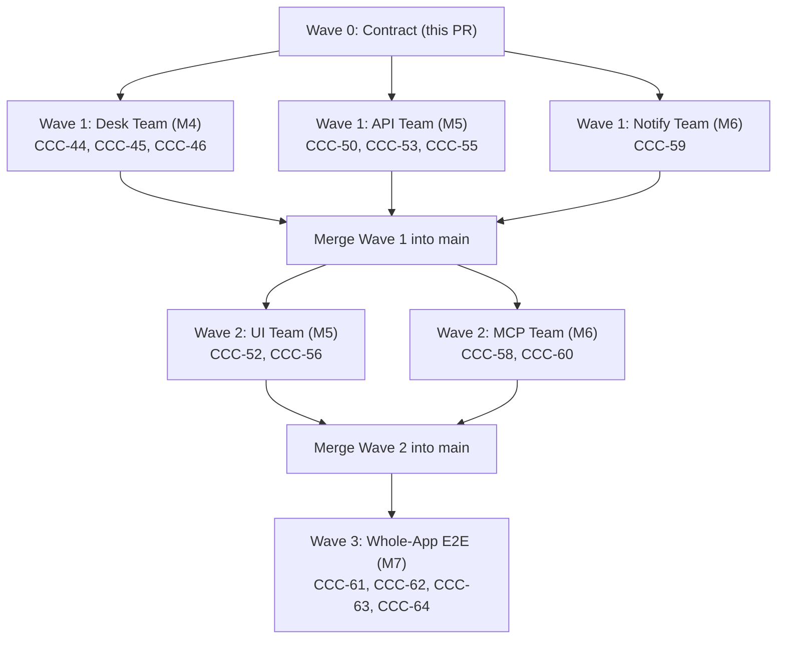

# Implementation Plan: Layer A, Milestone M3 (Market data from MT5, read-only)

## Overview

M3 replaces synthetic bars with XM's real history. A read-only importer copies bars from the MT5 terminal into a Parquet cache in UTC, masks the unusable stretches, and measures each symbol's Spread Floor and swap. The `market` facade then serves real bars to the Gauntlet exactly as it served synthetic ones, with the Holdout guard unchanged.

M3 adds no LLM (that is M4) and no app (M5). Its commands run from a `desk` CLI.

**Done when (spec §10):**
- a read-only import fills the cache;
- the UTC conversion is checked against `symbol_info_tick` times;
- Spread Floors are measured;
- `desk smoke` passes.

Detailed tasks: [todo.md](todo.md). Finished milestones: [done/](done/).

## Safety: read-only, by construction

- **The MT5 calls M3 may use** (spec §3.3, plus `symbol_info_tick`, which §10 needs, and `last_error` for diagnostics): `initialize`, `shutdown`, `last_error`, `symbol_info`, `symbol_info_tick`, `symbol_select`, `copy_rates_range`, `copy_ticks_range`, and the `TIMEFRAME_*` and `COPY_TICKS_*` constants. `symbol_select` only adds a symbol to the terminal's Market Watch, so that its history can be read.
- **Guard tests:**
  - The existing scan for `order_send`, `order_check`, `positions_*` and `orders_*` in `src/` stays.
  - New: an allowlist test parses `src/` and fails on any MetaTrader5 attribute outside the list above.
  - New: only `market/mt5_api.py` may import `MetaTrader5`, inside `real_api()`, which wraps it in `ReadOnlyMt5`: at run time every name off the allowlist raises, so even a name the scan missed can't reach an order call.
- **Agents and tests:** tests run on `FakeMt5` only. Agents may run the read-only commands (`desk smoke`, `desk import`, `desk floors`) against the real terminal; nothing in M3 can place, change or close an order.

## Definitions the tests depend on

These are fixed before code, so no test is tuned after the fact.

### Server clock to UTC (spec §2, §4)
- **MT5's numbers:** epoch seconds that MT5 returns are server wall-clock time written as if it were UTC. XM's server runs on European EET/EEST (`Europe/Athens`), while the market trading week runs on New York time.
- **Conversion:** `utc = server − offset`, where `offset` is the server zone's UTC offset at the server wall time. This inverts `server_offset(utc)` outside early Sunday morning.
- **No ambiguity for trading bars:** Europe switches its clock at 03:00 server time (01:00 UTC) on the last Sunday of March and October, while the market is closed. New York switches on US dates, so between the switches the FX week opens at server Sunday 23:00 (17:00 New York).
- **Requests:** `copy_rates_range` and `copy_ticks_range` take server-clock bounds. A UTC range is widened by one day on each side, converted, and trimmed back to the UTC range after conversion.
- **Checks:**
  - **Round trip:** utc → server → utc is the identity for every minute of 2014–2026 outside early Sunday morning (amended for CCC-85). With the server on `Europe/Athens`, switching at 01:00 UTC, the minutes that cannot be inverted are the first 1 h (spring) or 2 h (autumn) UTC of each switch Sunday: 13 × 60 + 13 × 120 = 2,340 minutes over 2014–2026; those fall on early Sunday morning, when the market is closed, and the tests pin them exactly.
  - **Structure (`check_clock`), on real data, per year:** every D1 bar opens at server midnight (17:00 New York outside mismatch weeks, 18:00 New York during mismatch weeks); every H4 bar opens at a server hour divisible by 4; every M15 bar sits on the 15-minute UTC grid. These catch our own bugs (times shifted between MT5 and the cache).
  - **XM's clock (amended for CCC-85), on real data, per year:** XM's server clock runs on `Europe/Athens` (EET/EEST) while the market trading week runs on New York time. Between the US and European daylight-saving switches, the FX market opens at server Sunday 23:00 (17:00 New York), creating a 1-hour Sunday bar and a 6-bar D1 week. GOLD opens at Sunday 18:00 New York (Monday 00:00 server time in mismatch weeks), so it has no Sunday bar. Checks a year must pass (matching `report.py`):
    - no M15 bar opens between Friday 17:00 and Sunday 17:00 New York;
    - no D1 bar covers a server day wholly in that weekend (a server Sunday bar is valid only in the weeks between the switches);
    - no server week has more than 5 D1 bars besides an opening Sunday bar;
    - GOLD's daily break sits at the same session hours in US summer and winter (session 00h, 17:00 New York; in mismatch weeks this is server 23:00 EET rather than server 00:00).

    A year that fails one of these blocks the checkpoint until it is explained and handled.
  - **Live tick (`desk smoke`):** while the market is open, the converted `symbol_info_tick` time is within 120 s of the system's UTC clock. At the weekend this check is skipped with a message, and the structural checks still run.

### Import and cache (spec §4)
- **Universe:** GOLD, EURUSD, GBPUSD, USDJPY, AUDUSD, USDCAD, USDCHF, NZDUSD. Timeframes M15, H1, H4 and D1, plus M1 for settling same-bar conflicts.
- **Range:** from `RESEARCH_START` (2014-01-01) to now. Holdout years are imported too: a Holdout run needs them, and only the `MarketData` facade, behind the grant, can read them.
- **Closed bars only:** each import fixes a cutoff time when it starts. Only bars that have closed by then (open time + timeframe ≤ cutoff) are cached. The bar still forming is never cached, so no partial bar is kept for good.
- **Chunks:** M1 by calendar month, the others by calendar year. MT5 may still be downloading history when first asked, so a chunk is accepted only when two reads in a row return the same closed bars (count and last time). Comparing closed bars only means a new bar arriving between reads does not stop the current chunk from settling.
- **Each symbol's cutoff** is the earlier of the clock and its last tick (T4).
- **History that lags the tick** (added after the independent review, 2026-10-23): a terminal that has just reconnected has a live tick while its history can still stop days earlier, and two reads agree on that. When a run's last closed M15 bar closed more than 2 hours before the symbol's cutoff, the symbol fails before any day is judged. Days are judged only before the day of the run's last M15 bar, which stays open; at a weekend, Friday is judged by the import that brings Monday.
- **Every timeframe or none:** a run that imports M15 judges days, and a judged day is served on every timeframe, so it must import all five. A refresh of some timeframes only leaves out M15 and judges nothing.
- **Served bars never change:** a chunk that would change any bar the cache serves (on a judged day the mask lets through) fails the import, naming the chunk and the first changed day. Masked days are never served, so bars a broker fills onto one later may change; it stays masked.
- **Layout:**
  - `data/bars/{symbol}/{timeframe}/{year}.parquet`: UTC `time` (int64), `open`, `high`, `low`, `close` (float64) and `spread` (int32).
  - `data/bars/{symbol}/meta.json`: point, digits, the first usable month, the masked days, the last import time.
- **Writes:** every file is written to a temporary name and renamed into place, so a crash never leaves half a year. On Windows a rename onto a file a reader holds open fails; it is retried 10 times, 0.1 s apart, then fails naming the file. One importer at a time, enforced by a lock file. (ADR 0006 makes the app the single writer; until M5 builds the app, the CLI writes, and M5 moves refresh into the app.)
- **Refresh:** incremental. It re-imports from the earlier of the chunk before the cutoff's and the chunk of the last import, through the cutoff's chunk (T4): a year or month that ended since, or a refresh missed for a while.

### Data-quality mask (spec §4)
- **First usable month:** the first calendar month in which the median count of M15 bars per server day reaches 50% of the symbol's median over the Research Window. Bars before it are excluded. GOLD is expected around mid-2014.
- **Thin days:** a server day with fewer than 50% of that median M15 count is excluded from every timeframe of the symbol. Every server weekday from the first usable month on is judged, with or without bars: a weekday with no M15 bars counts 0, so it is masked, and its bars on other timeframes are never served unvetted (added after the independent review). The median and each month's median day count only days with bars.
- **An import's first server day:** each timeframe's first chunk begins at a UTC midnight, two or three hours after its server day began, so the import holds only part of that day (on D1 and H4, not even its bar). The first import masks it whatever its count (added at T5).
- **Frozen at first import:** the median comes from the Research Window only (2014–2024), and the mask is stored in `meta.json`. A refresh adds new days to the mask but never re-judges old ones, so a Trial's bars, and their fingerprint in the Ledger, stay the same.
- **Where it applies:** `CachedBarSource` applies the mask on every read, so Trials and Holdouts see the same bars.

### Spread Floor and swap (spec §4, ADR 0004)
- **Spread Floor:** the median of `(ask − bid) / point` over the last 14 days of ticks (`copy_ticks_range` with `COPY_TICKS_INFO`), counting only ticks with both a bid and an ask. The 90th percentile and the tick count are stored with it. Only the spread is kept; the price levels of those ticks (Holdout-period data) are never stored or shown.
- **Swap:** `swap_long` and `swap_short` from `symbol_info`. The importer refuses a symbol whose `swap_mode` is not 1 (points per lot), and takes the triple-swap day from `swap_rollover3days`.
- **Store:** each measurement is appended to `data/costs/{symbol}.jsonl`. `current_cost(symbol)` returns the latest as a `CostSnapshot`, with 1 point of slippage and `as_of` set to the measurement date.
- **Weekly re-measurement:** `desk floors` runs it in M3; M5 schedules it.

### The `desk` CLI
- **`desk smoke`** (spec §9.7, run by hand): connect, read `symbol_info` for every symbol, check the live tick's UTC time, read the last day of GOLD M15 and one hour of ticks, disconnect. It prints a report and exits non-zero on any failure. It prints counts and times, never prices.
- **`desk import`**, **`desk refresh`**, **`desk floors`**: as defined above.
- **`desk data-report`:** per symbol, the first usable month, masked days per year, the structural clock checks per year, the median bar spread against the floor, and the gaps.

### Reports stop at the Holdout
Every report (the import report, `desk data-report`, `desk smoke`) is computed inside `market/`. For years from `HOLDOUT_START` on, it shows only structural facts: bar counts, clock checks, spreads and gaps. It never shows prices, returns or anything derived from them. Otherwise a report would be a side door into the Holdout (ADR 0002).

## Architecture decisions

- **One seam, two adapters (spec §3.3):** an `Mt5Api` Protocol in `market/mt5_api.py` lists exactly the allowed calls. The real adapter is the `MetaTrader5` module itself. The fake, `FakeMt5`, serves `SyntheticBarSource` data in server-clock time, with ticks and `symbol_info`. Everything above the seam is tested on the fake.
- **`Mt5BarSource(api)`:** a `BarSource` over the live terminal, converting to UTC. Only the importer uses it.
- **`CachedBarSource(root)`:** a `BarSource` over the Parquet cache, which applies the mask. This is what `MarketData` uses for real Trials. The existing guard (only `market` calls `.fetch`) now covers the cache too, plus a new check that only `market/cache.py` reads Parquet.
- **Dependencies:** `pyarrow` for the cache, and `MetaTrader5` (Windows only) as an optional `mt5` extra, so the tests never need a terminal.

## Task list

### Phase 0: the contract (here, before any parallel work)
- [ ] T0: `Mt5Api` Protocol, `FakeMt5`, dependencies, the `desk` entry point, the MT5 allowlist guard

### Phase 1: three tasks that own separate files and can run in parallel
- [ ] T1: Server clock to UTC + `Mt5BarSource`
- [ ] T2: Parquet cache + data-quality mask + `CachedBarSource`
- [ ] T3: Spread Floor + swap into a `CostSnapshot`

### Checkpoint A
- [ ] Default suite green on the fakes, ruff clean; the owner reviews

### Phase 2: integration (needs Phase 1)
- [ ] T4: Importer and refresh
- [ ] T5: `desk` commands: smoke, import, refresh, floors, data-report

### Checkpoint B
- [ ] A full import and refresh from `FakeMt5` into a temporary cache, read back through `MarketData`, is green; the owner reviews

### Phase 3: real data (here, read-only, against the XM demo terminal)
- [ ] T6: Real import of all 8 symbols, the data report, the Spread Floors, `desk smoke`
- [ ] T7: A timing and sanity run on real data, which records no result (see the open questions)

### Checkpoint C: M3 done
- [ ] The spec §10 M3 items are met; `uv run pytest` and `uv run pytest -m slow` are green; the owner reviews

## Risks and mitigations

| Risk | Impact | Mitigation |
|---|---|---|
| XM's server clock was set differently in early years | High: every early session filter and swap night would be off | Structural clock checks per year in the data report (T6); a failing year blocks the checkpoint |
| MT5 returns partial history while it downloads | High: silently short folds | Two matching reads per chunk (T4); bar counts per day checked against the frozen median (T2, T6) |
| The terminal's "Max bars in chart" setting caps a read | Medium | Monthly M1 chunks; the report flags a chunk that returns exactly the cap |
| Memory: M1 for 8 symbols × 12 years is about 30 million rows | Medium (about 4 GB free) | Import chunk by chunk, write per year, never hold a symbol's whole M1 |
| Real data breaks an engine assumption (zero-range bars, zero spread, long gaps) | Medium | T7 runs the Gauntlet on real GOLD M15 and checks for NaN, empty folds and timing |
| Holdout data sits in the cache | High if bypassed | Only `MarketData` reads the cache; guard tests (Parquet reads only in `market/cache.py`); reports show only structural facts for Holdout years |
| A forming bar or a year rollover leaves a partial bar in the cache | High: wrong bars kept for good | Closed bars only, by a cutoff fixed at the start; refresh re-imports the previous chunk too (T4) |
| A look at real results that the Ledger doesn't count | High: the anti-reset rule (ADR 0003) leaks | T7 records timing and sanity only, never a Verdict, profit factor or net R |
| GOLD's history starts mid-2014 | Low | The first fold trains on about 2.5 years; the report records the first usable month |
| A floor measured over a quiet or a wild fortnight | Low | The p90 and tick count are stored beside the median; ADR 0004's weekly re-measure |

## Owner decisions (2026-10-23)

- **The first real-data run (T7): timing and sanity only.** A result on real data that the Ledger doesn't count is exactly the uncounted look ADR 0003 exists to stop. So the Gauntlet runs on real GOLD M15 in a throwaway Ledger, and only the time and the sanity checks (no NaN, every fold has bars, baseline counts match) are recorded. The Verdict, profit factor and net R are never printed or written down. The real `data/desk.db` starts empty.
- **Re-runs after a rule change are charged** like any Trial, as built (ADR 0003 unchanged).
- **Phase 1 runs as three parallel worktree sessions** (T1, T2, T3), started after T0 is committed. Each owns only its listed files; merging waits for the owner.

## Carried forward

- **For M5 (the API and app):** the grant is reusable until the spend is recorded; bind each Holdout Request to its Trial id; run one family's Trials one at a time, since each reads the family's N when it starts (the Holdout gate re-checks N, but a Verdict card shows N as judged); schedule the nightly refresh and the weekly floors; a one-click start (double-click) that sets up and opens the app, so the owner can test it themselves (owner's request, 2026-10-23: wait for the real app rather than a demo now).
- **For Layer B (the live runner):** it always sits on the latest bar, where a time filter uses the clock's next open; it must re-check time filters against the bar it actually fills on.

---

# Layer A Teams: Waves 0 to 3 Implementation Plan

## 1. Overview and Architecture

The owner wants all of Layer A completed by parallel teams working in separate worktrees without touching each other's files.
Following the owner's directive since 2026-10-23 ("make it simple, done now"):
- Build the simplest working form that satisfies the specification.
- No unnecessary guards, reviews, or procedural checkpoints.
- Strict non-negotiable rule: **No orders, ever.** Nothing in `src/` may call MT5 order or position functions. MT5 is reached only through `real_api()`, which wraps it in `ReadOnlyMt5`. Tests use `FakeMt5` and `ScriptedLLM`.

## 2. Contract Summary (Wave 0)

Wave 0 defines the shared contracts, interfaces, and stubs so Wave 1 and Wave 2 teams can build in parallel without merge conflicts:

1. **`vibedesk.notify`** (spec §3.2, §3.3, §8.4):
   - `NoticeKind`: `candidate`, `pass`, `holdout_fail`, `holdout_request`, `token_warning`, `daily_digest`.
   - `Notice`: immutable dataclass (`kind`, `text`, `data`, `created_at`).
   - `Notifier(Protocol)`: `send(notice: Notice) -> bool`.
   - `RecordingNotifier`: fully implemented in-memory notifier for testing.
   - `TelegramNotifier`: push-only stub calling Telegram Bot API over httpx; token stored in git-ignored `data/secrets.json` (or env `VIBEDESK_TELEGRAM_BOT_TOKEN`), never logged.
   - `get_notifier(root, settings)`: factory wiring point.
2. **`vibedesk.desk.budget`** (spec §7.4, CCC-46):
   - `TokenBudget`: tracks OmniRoute `usage` against a daily token cap.
   - States: `ok` (<80%), `warn` (>=80% and <100%), `paused` (>=100%).
   - Daily reset: **00:00 Asia/Bangkok time (UTC+7)**, aligning with local desk operations, the 21:00 Bangkok daily digest, and the 02:00 Bangkok nightly refresh.
   - Methods: `record_usage(usage, when)`, `state(when)`, `status(when)`, `is_paused`, `remaining`.
3. **`vibedesk.desk.grounding`** (spec §7.3, ADR 0005, CCC-45 — owned in full by separate CCC-45 worker):
   - Grounding Rule interface called by the Desk team:
     - `validate(prose, *, known_tokens=None) -> list[str]`: returns list of problems (empty = ok). Enforces that assistant prose may not contain any digit except inside universe symbols, timeframes (`M1`, `M15`, `H1`, `H4`, `D1`), block names, or placeholders.
     - `render(prose: str, lookup) -> str`: resolves `{{trial:ID.metric}}`, `{{spec:ID.param}}`, `{{hyp:ID.field}}`, `{{date:ISO}}`.
   - Implementation of `src/vibedesk/desk/grounding.py` and `tests/test_grounding.py` is owned entirely by the parallel CCC-45 worker.
   - Wiring it into `desk/loop.py` (retry up to 2 times on validation failure, then withhold explanation) stays with the Desk team in Wave 1.
4. **`vibedesk.desk.tools`** (spec §7.2, CCC-44):
   - `DeskContext`: dependency container (`ledger`, `market`, `family_id`, `budget`, `notifier`, `root`).
   - `build_desk_tools(ctx: DeskContext) -> ToolRegistry`: builds the 7 tools from spec §7.2:
     - `list_blocks()`: returns the Block Library.
     - `describe_data(symbol, timeframe)`: Research Window statistics (coverage, Spread Floor, ATR levels).
     - `draft_spec(spec)`: validates a Strategy Spec and returns grid size (0 Trials counted).
     - `register_hypothesis(spec, family_id)`: freezes a Hypothesis in the Ledger.
     - `run_trial(hypothesis_id)`: runs the Gauntlet, counts 1 Trial, refused if budget spent.
     - `get_trial(trial_id)`: retrieves stored results and metrics.
     - `request_holdout(hypothesis_id)`: submits Holdout Request through the gate in spec §6.3.
5. **`vibedesk.app.scheduler`** (spec §4, §8.4, CCC-53):
   - Manages background scheduled tasks:
     - `nightly_refresh`: 02:00 Asia/Bangkok daily (read-only incremental bar import from MT5).
     - `weekly_spread_floors`: 00:00 Asia/Bangkok Sunday (re-measures tick p50 spreads and swaps).
     - `daily_digest`: 21:00 Asia/Bangkok daily (Telegram push of REJECTs, Trials run, tokens used).
   - Signatures: `start()`, `stop()`, `is_running`, `jobs()`, `run_job_now(name)`.
6. **`vibedesk.app.auth`** (spec §8.1, CCC-50):
   - Owner actions (approve Holdout, extend budget, update settings) require the owner cookie:
     `OWNER_COOKIE_NAME = "vibedesk_owner"`.
   - UI page sets the cookie on `127.0.0.1:8765`: `SameSite=Strict; Path=/`.
   - `require_owner` FastAPI dependency raises HTTP 403 on missing/invalid cookie.
7. **`vibedesk.app.api_spec`** (spec §8.1, §8.2, CCC-50, CCC-58):
   - Complete Pydantic schemas for all endpoints in spec §8.1.
   - `ENDPOINT_TABLE`: 15 endpoints with methods, owner-only flags, and payload types.
   - `MCP_TOOL_MAP`: 8 tools mapped to API endpoints (5 read, 3 act; no owner tools).
8. **`vibedesk.app.settings`**:
   - Keys: `llm_url`, `llm_model`, `llm_key`, `daily_token_cap`, `telegram_enabled`, `telegram_chat_id`.
   - Secrets (`telegram_bot_token`) stored in git-ignored `data/secrets.json` (or environment), never returned in `public()`.
9. **CCC-55 Carry-Forwards**:
   - **Grant reusability:** a `HoldoutGrant` is reusable until the spend is recorded in `holdout_spends`.
   - **Binding:** bind each Holdout Request to its `trial_id`.
   - **Trial serialization per family:** run one Idea Family's Trials one at a time using a per-family lock, since each Trial reads the family's combination count $N$ when it starts. The Verdict Card displays $N$ as judged; the Holdout gate re-checks $N$ at request time.
   - **Holdout Gate:** only CANDIDATE Trials under current `RULES_VERSION` with Deflated Sharpe $\ge 0.95$ at current $N$ and expected Holdout trades $\ge 30$ pass.

## 3. File Ownership Table

To ensure zero merge conflicts during parallel execution across worktrees, each team has strict file ownership:

| File / Directory | Owning Team | Milestone Card | Wave | Notes |
|---|---|---|---|---|
| `src/vibedesk/notify/__init__.py` | Notify Team | CCC-59 | Wave 1 | Implement `TelegramNotifier.send` via Bot API |
| `scripts/setup-telegram.ps1` | Notify Team | CCC-59 | Wave 1 | Script to prompt and write `data/secrets.json` |
| `tests/test_notify.py` | Notify Team | CCC-59, CCC-60 | Wave 1 | Tests for Telegram notices, digest, RecordingNotifier |
| `src/vibedesk/desk/tools.py` | Desk Team | CCC-44 | Wave 1 | Full implementation of the 7 tools against Ledger & Market |
| `src/vibedesk/desk/grounding.py` | CCC-45 Worker | CCC-45 | Wave 1 | Built in full by separate CCC-45 worker (validate & render) |
| `src/vibedesk/desk/budget.py` | Desk Team | CCC-46 | Wave 1 | Wire budget check & warning notices into desk loop |
| `src/vibedesk/desk/loop.py` | Desk Team | CCC-45, CCC-46 | Wave 1 | Wires grounding retries and budget pause into desk loop |
| `src/vibedesk/desk/__init__.py` | Desk Team | CCC-44, CCC-45 | Wave 1 | Re-exports; CCC-45 worker does not edit; Desk Team adds grounding export |
| `tests/test_desk_tools.py` | Desk Team | CCC-44 | Wave 1 | Tests for the 7 desk tools |
| `tests/test_grounding.py` | CCC-45 Worker | CCC-45 | Wave 1 | Owned and tested in full by separate CCC-45 worker |
| `tests/test_budget.py` | Desk Team | CCC-46 | Wave 1 | Tests for token counting, 80% warning, 100% pause |
| `src/vibedesk/app/server.py` | API Team | CCC-50 | Wave 1 | Wire new endpoints per spec §8.1, `require_owner` |
| `src/vibedesk/app/auth.py` | API Team | CCC-50 | Wave 1 | Owner cookie dependency enforcement |
| `src/vibedesk/app/settings.py` | API Team | CCC-50 | Wave 1 | Owns for `PUT /api/settings`; Notify Team uses `load_secrets`/`save_secrets` without editing |
| `src/vibedesk/app/scheduler.py` | API Team | CCC-53 | Wave 1 | Background thread/loop for the 3 scheduled jobs |
| `tests/test_api.py` | API Team | CCC-50, CCC-55 | Wave 1 | Tests for HTTP API endpoints & owner-only refusals |
| `tests/test_scheduler.py` | API Team | CCC-53 | Wave 1 | Tests for scheduler execution and timing |
| `tests/test_carry_forwards.py` | API Team | CCC-55 | Wave 1 | Tests for grant reusability, Holdout Request binding, family lock |
| `tests/test_contract.py` | Contract (Wave 0) | Wave 0 | Wave 0 | Baseline test of Wave 0 contracts; frozen after Wave 0 (see rules below) |
| `src/vibedesk/app/static/index.html` | UI Team | CCC-52, CCC-56 | Wave 2 | 4 pages (Desk, Ideas, Ledger, Settings), 375 px layout, owner cookie |
| `tests/test_ui_playwright.py` | UI Team | CCC-56 | Wave 2 | Playwright E2E on fakes; 375 px mobile viewport check |
| `src/vibedesk/mcp/` | MCP Team | CCC-58, CCC-60 | Wave 2 | Stdio MCP server calling HTTP API (read/act tools only) |
| `tests/test_mcp.py` | MCP Team | CCC-58, CCC-60 | Wave 2 | Tests for MCP tools and owner-only tool exclusions |
| `tests/test_m7_whole_app.py` | Whole-App Team | CCC-61, CCC-62 | Wave 3 | Deterministic end-to-end suite across all layers |
| `CLAUDE.md` | Whole-App Team | CCC-64 | Wave 3 | Document whole-app run, test, and verification commands |

### Shared Files Rules
- `src/vibedesk/app/server.py`: owned exclusively by the **API Team**. The UI team works strictly in `static/index.html` and does not edit `server.py`.
- `src/vibedesk/desk/loop.py` & `src/vibedesk/desk/__init__.py`: owned exclusively by the **Desk Team**. The CCC-45 worker only writes `src/vibedesk/desk/grounding.py` and `tests/test_grounding.py`; the Desk Team wires grounding into `loop.py` and re-exports it in `__init__.py`.
- `src/vibedesk/app/settings.py`: owned exclusively by the **API Team** for `PUT /api/settings`. The Notify Team consumes `load_secrets`/`save_secrets` without modifying `settings.py`.
- `tests/test_contract.py`: frozen after Wave 0. When a Wave 1 team implements a stubbed function (e.g. Desk Team in CCC-44 or API Team in CCC-53), they remove only the specific `NotImplementedError` stub assertion in `test_contract.py` for that component in their own PR, and test the real implementation in their own dedicated test file (`test_desk_tools.py`, `test_scheduler.py`).
- `pyproject.toml`: dependencies are frozen by Wave 0 (`fastapi`, `httpx`, `numba`, `numpy`, `pyarrow`, `pydantic`, `tzdata`, `uvicorn`, `pytest`, `ruff`). If MCP team requires `mcp`, add via `uv add mcp`.
- `src/vibedesk/ledger/store.py`: read-only reference for tools and API. Any schema migrations must be coordinated and append-only.
- `data/`: ignored by git. Never commit `data/` or secrets.

## 4. Wave Merge Order

1. **Wave 0 (Contract)**: Merged into `main` first. Provides all interfaces, schemas, and test harnesses.
2. **Wave 1 (Parallel Worktrees)**:
   - Branch `feature/desk-m4`: Desk Team (CCC-44, CCC-45, CCC-46).
   - Branch `feature/api-m5`: API Team (CCC-50, CCC-53, CCC-55).
   - Branch `feature/notify-m6`: Notify Team (CCC-59).
   All three branches develop independently without touching overlapping files. Merged into `main` after automated tests pass.
3. **Wave 2 (Parallel Worktrees)**:
   - Branch `feature/ui-m5`: UI Team builds on the completed HTTP API in `src/vibedesk/app/static/index.html`.
   - Branch `feature/mcp-m6`: MCP Team builds `src/vibedesk/mcp/` calling the HTTP API.
   Merged into `main` after automated tests pass.
4. **Wave 3 (Integration & Verification)**:
   - Branch `feature/whole-app-m7`: Whole-app test suite, click-through validation, and `CLAUDE.md` updates.

## 5. Acceptance Checklist Per Card

### Wave 1: Desk Team (M4)
- [ ] **CCC-44 Desk tools**:
  - `list_blocks`: returns all blocks from `LIBRARY.all()`.
  - `describe_data(symbol, tf)`: returns bar count, start/end date, spread floor, ATR p50 for Research Window.
  - `draft_spec(spec)`: validates spec, normalizes mixed numbers, returns combinations count, counts 0 Trials.
  - `register_hypothesis(spec, family_id)`: freezes Hypothesis in Ledger, links to current or existing family.
  - `run_trial(hypothesis_id)`: executes Gauntlet via `trial.run_trial`, charges 1 Trial against budget, raises if budget exhausted.
  - `get_trial(trial_id)`: returns stored record and summary from Ledger.
  - `request_holdout(hypothesis_id)`: checks §6.3 gate (CANDIDATE, rules version, Deflated Sharpe, expected trades >= 30).
- [ ] **CCC-45 Grounding Rule (owned in full by separate CCC-45 worker)**:
  - `validate(prose, *, known_tokens=None) -> list[str]`: problems (empty = ok); rejects any digit unless inside allowed symbol, timeframe, block name, or valid placeholder.
  - `render(prose: str, lookup) -> str`: resolves `{{trial:ID.metric}}`, `{{spec:ID.param}}`, `{{hyp:ID.field}}`, `{{date:ISO}}`.
  - Built and tested in full by separate worker (`src/vibedesk/desk/grounding.py` and `tests/test_grounding.py`).
  - Wiring into `desk/loop.py` (retry up to 2 times on validation failure; withhold explanation if still failing) stays with Desk Team in Wave 1.
- [ ] **CCC-46 Daily token budget**:
  - Count tokens from OmniRoute usage responses.
  - Trigger `token_warning` Notice to Notifier at 80% of daily cap (once per day).
  - Pause Desk loop at 100% of daily cap, explaining clearly to owner. Manual Trials still permitted.
  - Daily reset at 00:00 Asia/Bangkok time.

### Wave 1: API Team (M5 Backend)
- [ ] **CCC-50 HTTP API per spec §8.1**:
  - Implement all 15 endpoints in `ENDPOINT_TABLE`.
  - Enforce `require_owner` dependency on owner-only actions (`approve_holdout`, `extend_budget`, `PUT /api/settings`). Missing cookie returns HTTP 403.
  - Wire `POST /api/families/{id}/chat` to SSE stream running `desk_loop` with `build_desk_tools`.
- [ ] **CCC-53 Scheduler**:
  - Background thread running `nightly_refresh` (02:00 Bangkok), `weekly_spread_floors` (Sunday 00:00 Bangkok), and `daily_digest` (21:00 Bangkok).
  - Support `run_job_now(name)` for immediate manual or test triggering.
- [ ] **CCC-55 Holdout and Trial carry-forwards**:
  - Reusable Holdout grant until spend is recorded.
  - Bind Holdout Request to Trial ID.
  - Serialize Trial runs per Idea Family to freeze combination count $N$ consistently.

### Wave 1: Notify Team (M6 Part)
- [ ] **CCC-59 Telegram notices & daily digest**:
  - `TelegramNotifier.send` posts notices (CANDIDATE, PASS, HOLDOUT FAIL, Holdout Request awaiting owner, token warning).
  - Format and send 21:00 Bangkok daily digest (REJECTs, Trials, tokens used).
  - `scripts/setup-telegram.ps1` writes bot token to `data/secrets.json`. Secrets never logged.

### Wave 2: UI Team (M5 Frontend)
- [ ] **CCC-52 Ideas, Ledger, Settings pages in one-page app**:
  - Single-page application in `src/vibedesk/app/static/index.html`.
  - Navigation between Desk, Ideas, Ledger, and Settings.
  - UI automatically sets `vibedesk_owner` cookie on load.
  - Verdict Cards display stitched equity curve, fold bars, baseline histogram, Pass Bar checks, Closest Miss.
- [ ] **CCC-56 Layout at 375 px and Playwright E2E on fakes**:
  - Clean responsive design at 375 px phone width with no horizontal overflow/scroll.
  - Playwright test suite running against deterministic backend fakes.

### Wave 2: MCP Team (M6 Part)
- [ ] **CCC-58 MCP Server**:
  - Stdio MCP server calling HTTP API on `127.0.0.1:8765`.
  - Exposes 5 read tools and 3 act tools per spec §8.2.
  - Does NOT expose owner-only tools (no approve, no budget, no settings).
- [ ] **CCC-60 Test owner-only refusals & RecordingNotifier**:
  - Automated tests asserting MCP client cannot call owner endpoints and receives HTTP 403.
  - Tests verifying notices arrive in `RecordingNotifier`.

### Wave 3: Whole-App Team (M7)
- [ ] **CCC-61 / CCC-62 Whole-app E2E**:
  - End-to-end integration test on deterministic fakes from chat to Verdict Card.
- [ ] **CCC-63 Exploratory click-through**:
  - Verification across all pages, zero browser console errors, responsive layout at 375 px.
- [ ] **CCC-64 CLAUDE.md commands**:
  - Update `CLAUDE.md` with complete whole-app execution, testing, and maintenance commands.
